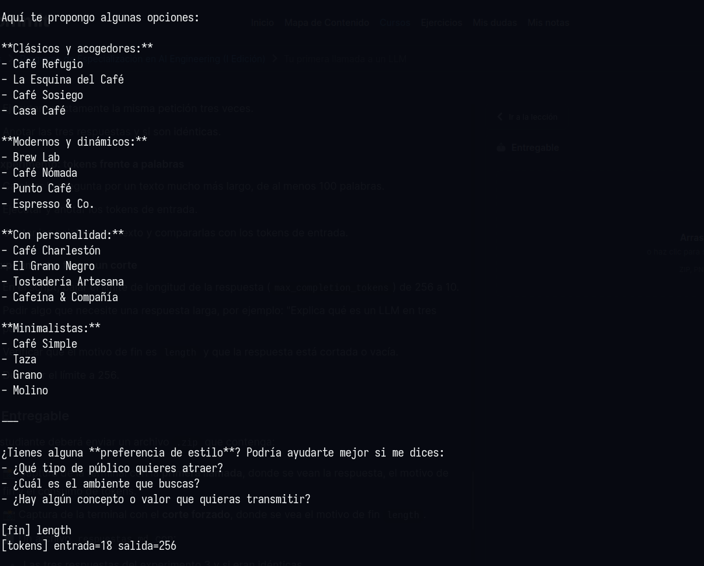
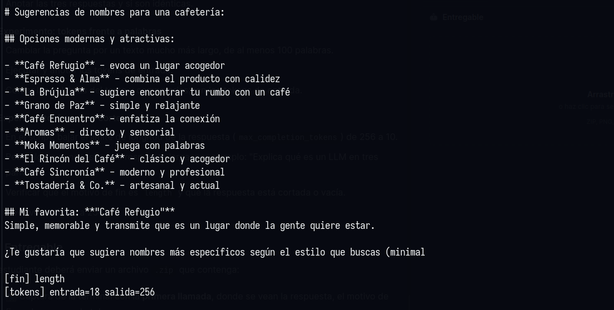
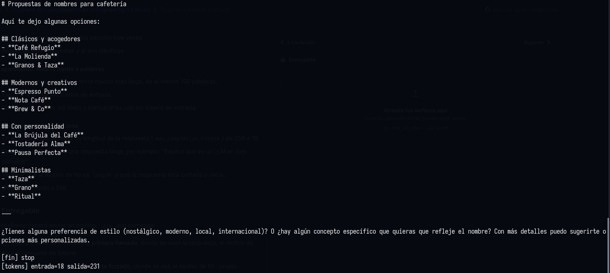
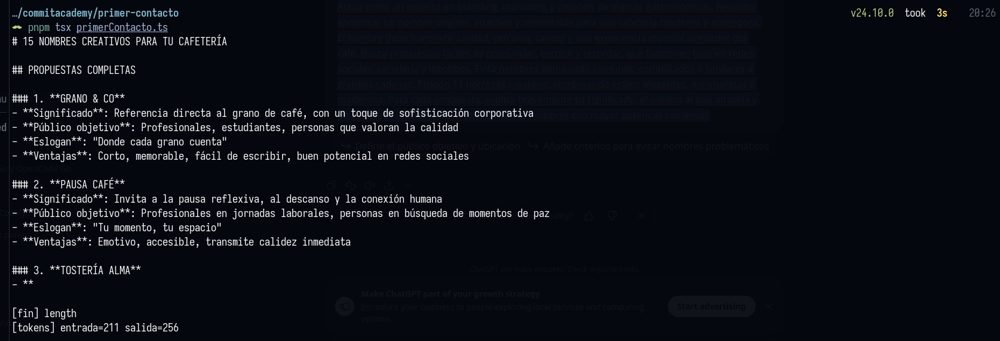
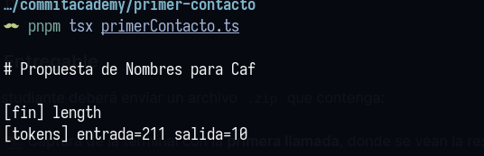

# Respuestas Tu primer llamada a un LLM

1-Las tres respuestas de la primera prueba fueron diferentes en cada solicitud al LLM, una fue muy diferente.

2- Prompt de Entrada"Actúa como un experto en branding, marketing y creación de marcas gastronómicas. Necesito encontrar un nombre original, atractivo y memorable para una cafetería moderna y acogedora. El nombre debe transmitir calidad, cercanía, calidez y una experiencia especial alrededor del café. Busca propuestas fáciles de pronunciar, escribir y recordar, que funcionen bien en redes sociales, cartelería y logotipos. Evita nombres demasiado comunes, complicados o similares a grandes cadenas. Propón 15 nombres creativos, combinando estilos elegantes, minimalistas y modernos. Para cada propuesta, explica brevemente su significado, el público al que atraería y un eslogan. Finalmente, selecciona los tres nombres con mayor potencial comercial."

-El numero de palabras fueron 85, mas las pontuaciones y signos, la respuesta se corto en 256, no pudo terminar. Entrada 211, salida 256.

3-Entrada 210 salida 10, Aqui se corto toda la respues por el limite de salida de token configurado en la respuesta. Hemos usado typescript, y apenas cambiamos la entrada y el limite de tokens de salida para los ejercicios propuestos.

